# 파이썬 기초 퀴즈 게임

Python으로 만든 터미널 퀴즈 게임입니다.
문제를 풀거나 직접 등록하고, 최고 점수와 게임 기록을 파일에 저장합니다.

## 1. 프로젝트 개요

Python 기본 문법, 클래스, JSON 파일 입출력, Git을 학습하기 위한 프로젝트입니다.

- 기본 문제 10개 제공
- 문제마다 선택지 4개 제공
- 정답을 1~4의 정수로 관리
- Quiz와 QuizGame 클래스로 역할 분리
- 프로젝트 루트의 state.json에 게임 데이터 저장
- 외부 라이브러리 없이 표준 라이브러리만 사용

## 2. 퀴즈 주제와 선정 이유

주제는 파이썬 기초입니다.

퀴즈 게임을 구현하면서 파이썬 개념도 함께 복습하기 위해 선택했습니다.
기본 문제는 출력, 입력, 자료형, 조건문, 반복문, 함수에 관한 내용으로 구성했습니다.

## 3. 개발 환경

| 항목 | 내용 |
|---|---|
| 운영체제 | Windows |
| 개발 도구 | Visual Studio Code |
| 사용 언어 | Python |
| 필요한 Python 버전 | 3.10 이상 |
| 실제 검증 버전 | Python 3.14.10 |
| 버전 관리 | Git / GitHub |
| 외부 패키지 설치 | 필요 없음 |

사용한 표준 라이브러리는 json, math, pathlib, random, datetime입니다.
파일 오류 모의 검증에는 표준 라이브러리 unittest.mock을 사용했습니다.

## 4. 실행 방법

### 저장소 다운로드

터미널에서 다음 명령어를 순서대로 실행합니다.

```bash
git clone https://github.com/SonJH0/python-quiz-game.git
cd python-quiz-game
python --version
python main.py
```

환경에 따라 python 대신 python3 또는 py 명령을 사용할 수 있습니다.

추가로 설치할 외부 패키지는 없습니다.

### 프로그램 사용 방법

실행하면 다음 메뉴가 표시됩니다.

| 번호 | 기능 |
|---|---|
| 1 | 퀴즈 풀기 |
| 2 | 퀴즈 추가 |
| 3 | 퀴즈 목록 |
| 4 | 최고 점수 확인 |
| 5 | 퀴즈 삭제 |
| 6 | 게임 기록 확인 |
| 0 | 저장 후 종료 |

프로그램의 `메뉴 번호:`에는 메뉴 숫자를 입력합니다.
python이나 git 명령어는 프로그램을 종료한 후 터미널에서 실행합니다.

## 5. 기능 목록

### 기본 기능

| 기능 | 설명 |
|---|---|
| 메뉴 | 번호를 선택하여 기능 실행 |
| 퀴즈 풀기 | 문제와 선택지를 표시하고 정답 입력 및 판정 |
| 퀴즈 추가 | 문제, 선택지 4개, 정답 번호, 선택적 힌트 등록 |
| 퀴즈 목록 | 저장된 문제를 번호와 함께 표시 |
| 최고 점수 | 완료한 게임의 환산 점수와 비교하여 갱신 |
| 파일 저장 | 퀴즈와 최고 점수, 게임 기록 저장 |
| 파일 불러오기 | 재실행 시 이전 데이터 복원 |

### 보너스 기능

| 기능 | 구현 내용 |
|---|---|
| 랜덤 출제 | random.sample()로 중복 없이 무작위 선택 |
| 문제 수 선택 | 1개부터 현재 등록된 전체 문제 수까지 선택 |
| 힌트 | 문제당 최대 1회 사용, 사용 시 정답 점수 감소 |
| 퀴즈 삭제 | 문제 선택 후 확인 또는 취소, 삭제 결과 저장 |
| 게임 기록 | 완료 시간, 문제 수, 정답 수, 힌트 수, 점수 저장 및 조회 |

## 6. 점수 규칙

| 결과 | 문제당 획득 점수 |
|---|---:|
| 힌트 없이 정답 | 10점 |
| 힌트 사용 후 정답 | 5점 |
| 오답 | 0점 |

최고 점수는 다음과 같이 100점으로 환산하여 비교합니다.

```text
환산 점수 = 획득 점수 / (푼 문제 수 × 10) × 100
```

소수점은 한 자리까지 반올림합니다.

예시:

- 3문제 중 힌트 없이 2개 정답: 20/30점 → 66.7점
- 1문제에서 힌트를 사용하고 정답: 5/10점 → 50.0점
- 1문제에서 힌트 없이 정답: 10/10점 → 100.0점

문제 수가 달라도 같은 환산 기준으로 최고 점수를 비교합니다.
다만 문제 수와 난이도에 따른 성취도 차이까지 보정하는 방식은 아닙니다.

게임을 끝까지 완료했을 때만 최고 점수와 게임 기록에 반영합니다.
도중에 입력을 중단한 게임은 완료 기록에 추가하지 않습니다.

## 7. 파일 구조

| 경로 | 역할 |
|---|---|
| main.py | 게임 시작 및 입력 중단 처리, 종료 시 저장 |
| quiz.py | 개별 문제를 표현하는 Quiz 클래스 |
| quiz_game.py | 메뉴, 게임 진행, 등록, 조회, 삭제, 점수 관리 |
| default_quizzes.py | 기본 Quiz 객체 10개 생성 |
| storage.py | JSON 저장, 불러오기, 데이터 형태 검증 |
| state.json | 실행 중 생성되는 게임 데이터 |
| .gitignore | 자동 생성 파일과 게임 데이터의 Git 추적 제외 |
| README.md | 프로젝트 설명과 사용 방법 |
| docs/test-checklist.md | 실제 기능 및 예외 처리 검증 결과 |

state.json과 __pycache__는 자동 생성되며 Git 관리에서 제외합니다.
저장소를 내려받은 직후 state.json이 없는 것은 정상입니다.

## 8. 클래스와 기능 분리

### Quiz

문제 하나를 표현합니다.

| 구분 | 내용 |
|---|---|
| 속성 | question, choices, answer, hint |
| display() | 문제와 선택지 출력 |
| is_correct() | 입력한 정답 번호와 실제 정답 비교 |
| to_dict() | 저장을 위해 딕셔너리로 변환 |

### QuizGame

게임 전체를 관리합니다.

| 메서드 | 역할 |
|---|---|
| load_data(), save_data() | 저장 담당 함수와 연결하여 데이터 불러오기 및 저장 |
| read_number(), read_text() | 공통 입력 처리 |
| show_menu(), run() | 메뉴 표시 및 실행 흐름 관리 |
| play(), offer_hint() | 문제 출제, 힌트, 채점 |
| add_quiz(), list_quizzes(), delete_quiz() | 문제 등록, 목록, 삭제 |
| update_best_score(), show_best_score() | 최고 점수 관리 |
| record_game(), show_history() | 완료한 게임 기록 관리 |

## 9. 데이터 파일 설명

### 경로와 인코딩

데이터는 프로젝트 루트의 state.json에 UTF-8로 저장합니다.

파일 경로는 storage.py의 위치를 기준으로 계산합니다.
따라서 터미널에서 실행하는 현재 폴더가 달라도 같은 데이터 경로를 사용하도록 구현했습니다.

한글은 ensure_ascii=False로 저장하고, indent=2로 들여쓰기합니다.

### 데이터 구조

아래는 구조 설명을 위한 예시이며, 기본 문제 전체를 나타내지는 않습니다.

```json
{
  "quizzes": [
    {
      "question": "파이썬에서 화면에 내용을 출력하는 함수는?",
      "choices": ["input()", "print()", "int()", "len()"],
      "answer": 2,
      "hint": "영어로 인쇄한다는 뜻입니다."
    }
  ],
  "best_score": null,
  "history": []
}
```

| 키 | 설명 |
|---|---|
| quizzes | 현재 등록된 문제 목록 |
| question | 문제 내용 |
| choices | 선택지 4개 |
| answer | 1~4의 정답 번호 |
| hint | 힌트 문자열, 생략하면 빈 문자열 |
| best_score | 최고 환산 점수, 기록이 없으면 null |
| history | 완료한 게임 기록 목록 |

각 게임 기록에는 다음 항목을 저장합니다.

| 키 | 설명 |
|---|---|
| played_at | 완료 시각과 컴퓨터의 현지 시간대 |
| question_count | 푼 문제 수 |
| correct_count | 정답 수 |
| hint_count | 힌트 사용 횟수 |
| earned_points | 획득 점수 |
| score | 100점 환산 점수 |

### 저장 시점

- 문제 추가 직후
- 문제 삭제 직후
- 게임 완료 직후
- 정상 종료 또는 입력 중단 후 가능한 범위에서 종료할 때

임시 파일 state.json.tmp에 데이터를 기록한 뒤 state.json으로 교체합니다.
저장에 실패하면 실패 안내를 출력합니다.

### 파일 없음과 손상 처리

- 파일이 없으면 기본 문제 10개로 시작합니다.
- JSON 문법이나 주요 데이터 형태가 잘못되면 안내 후 기본 데이터로 시작합니다.
- 읽기와 쓰기 오류는 예외 처리하여 안내합니다.
- 빈 quizzes 목록은 정상 상태로 인정합니다.
- 최고 점수 null과 실제 점수 0을 구분합니다.

기본 데이터로 시작한 후 저장에 성공하면 기존 파일은 초기 데이터로 교체됩니다.
손상된 파일의 원래 내용을 복원하거나 자동 백업하는 기능은 없습니다.

## 10. 입력 및 예외 처리

- 숫자 입력 전후 공백 제거
- 빈 입력 안내 및 재입력
- 숫자로 변환할 수 없는 입력 안내 및 재입력
- 허용 범위 밖 숫자 안내 및 재입력
- 문제와 선택지의 빈 문자열 및 공백만 있는 입력 거부
- KeyboardInterrupt와 EOFError 처리
- 저장 파일 없음, JSON 손상, 읽기·쓰기 실패 처리
- 문제 없음, 점수 없음, 게임 기록 없음 처리

## 11. 검증 결과

등록, 목록, 플레이, 점수, 랜덤 출제, 문제 수 선택, 힌트, 삭제, 기록을 실제 실행으로 확인했습니다.

추가한 문제, 최고 점수, 삭제 결과, 게임 기록이 종료 후 다시 실행해도 유지되는 것을 확인했습니다.

Ctrl+C, EOF 입력, 저장 파일 없음, 손상된 JSON, 잘못된 정답 번호, 빈 데이터 상태도 확인했습니다.

파일 읽기·쓰기 실패는 unittest.mock으로 PermissionError를 발생시키는 모의 검증을 수행했습니다.

상세한 확인 결과와 검증 범위는 [검증 기록](docs/test-checklist.md)에 정리했습니다.

## 12. Git 작업 방식

기능을 구현하고 실행 결과를 확인한 뒤 기능 단위로 커밋했습니다.

| 브랜치 | 작업 내용 |
|---|---|
| main | 병합된 기능과 제출 문서 관리 |
| feature/quiz-play | QuizGame 기반 퀴즈 풀이 구현 |
| feature/bonus | 보너스 기능 5종 구현 |

두 기능 브랜치는 main에 --no-ff 옵션으로 병합하여 병합 커밋을 남겼습니다.

기록 확인 명령어:

```bash
git log --oneline --graph --all
git rev-list --count --no-merges main
```

별도 폴더에서 clone 후 문서를 추가하여 commit과 push를 수행했습니다. 기존 작업 폴더에서 pull로 해당 변경을 가져오고 문서 내용과 Git 상태를 확인했습니다.

자세한 과정은 [clone과 pull 실습 기록](docs/clone-practice.md)에 정리했습니다.

## 13. 실행 화면 및 제출 증빙

# 실행 화면 및 제출 증빙

제출용 화면 14장을 선별해 이름을 정리했습니다. 이미지는 업로드한 원본 그대로입니다.
그 밖의 업로드 사진은 screenshots/originals 폴더에 보관했습니다.

## 개발 환경

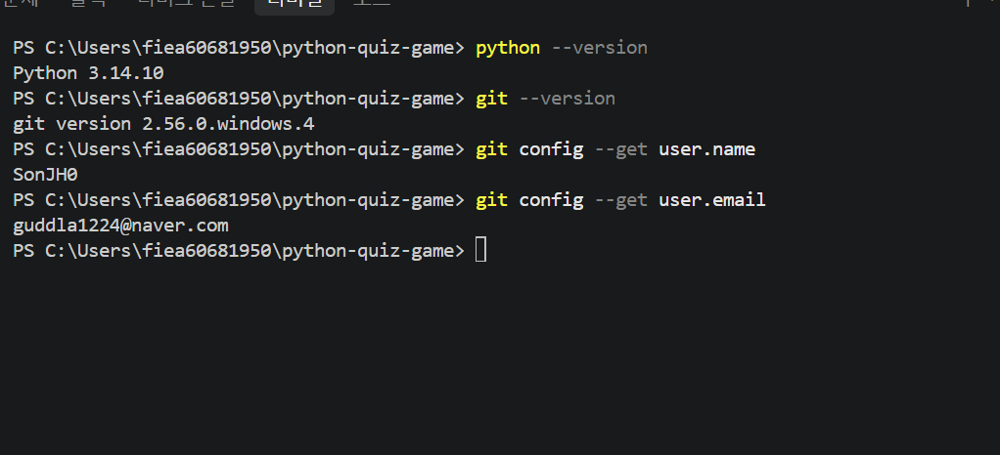

## 퀴즈 추가

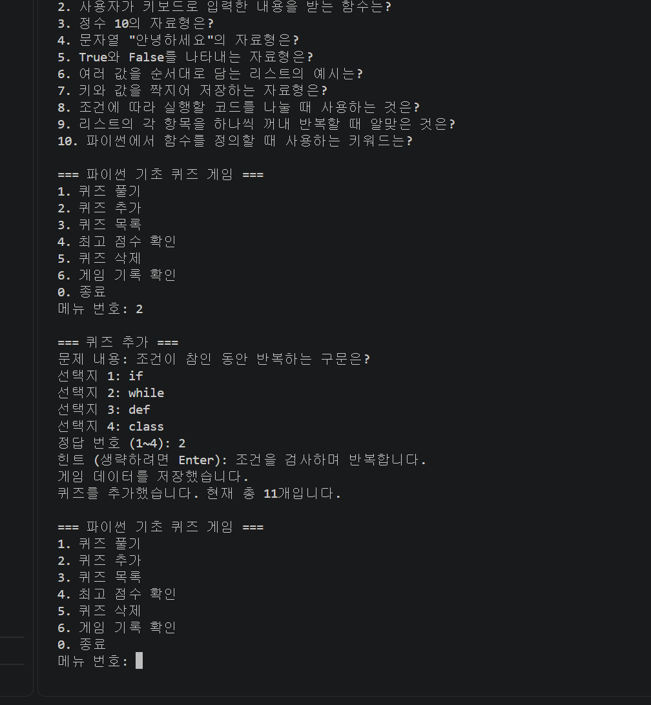

## 퀴즈 목록

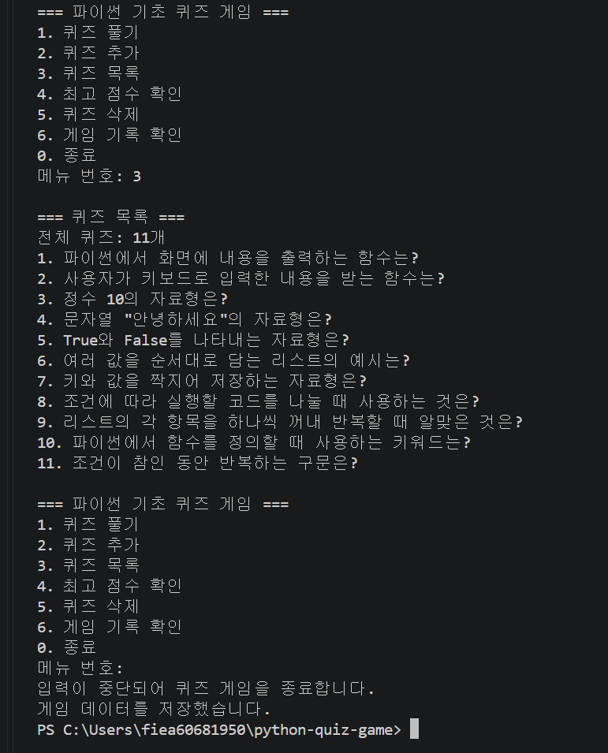

## 플레이와 힌트

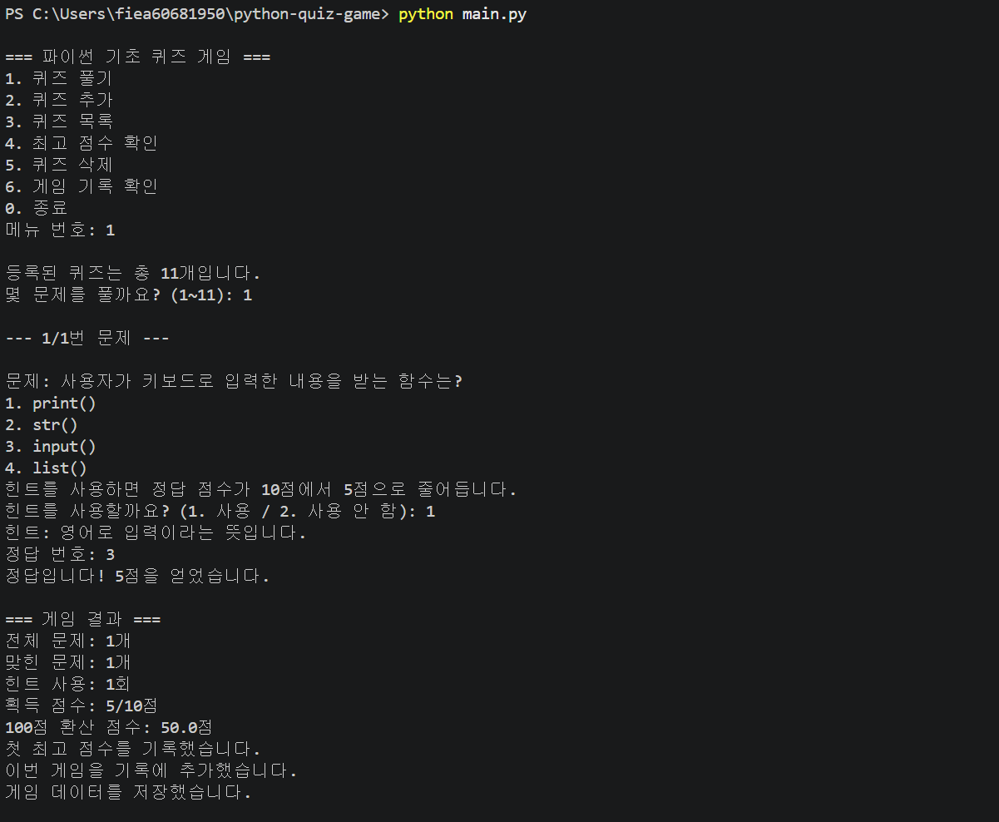

## 최고 점수

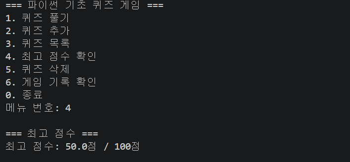

## 게임 기록

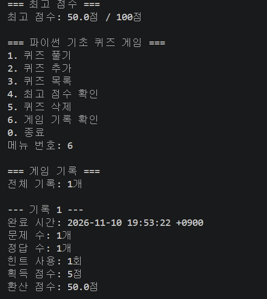

## Git 변경 및 병합 기록

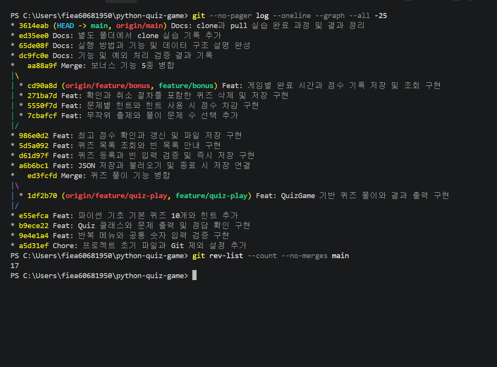

## clone 실행

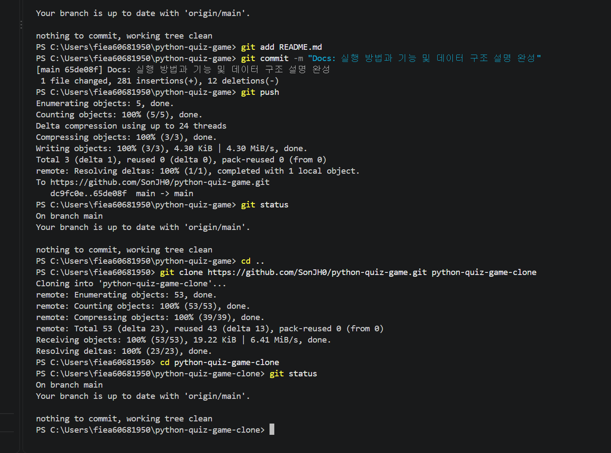

## pull 및 변경 반영

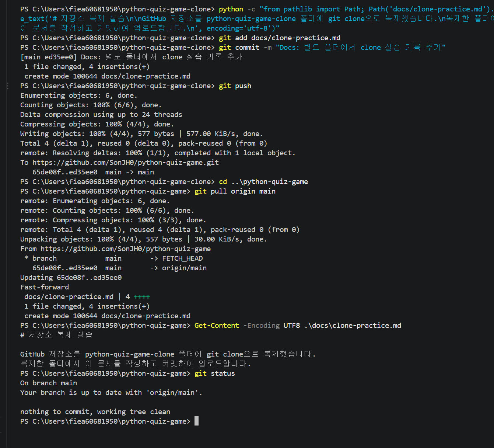

## 삭제 및 목록 확인

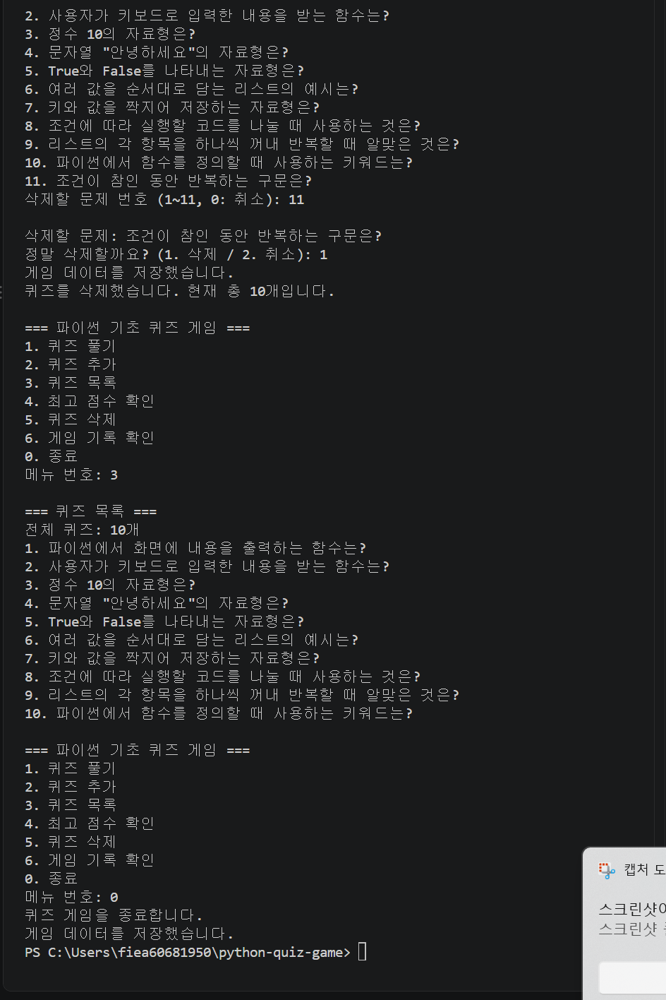

## Ctrl+C 및 EOF 종료

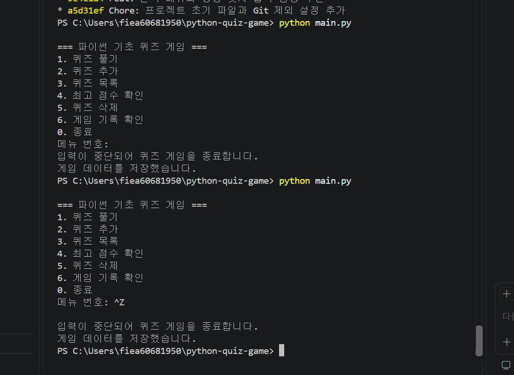

## JSON 손상 복구

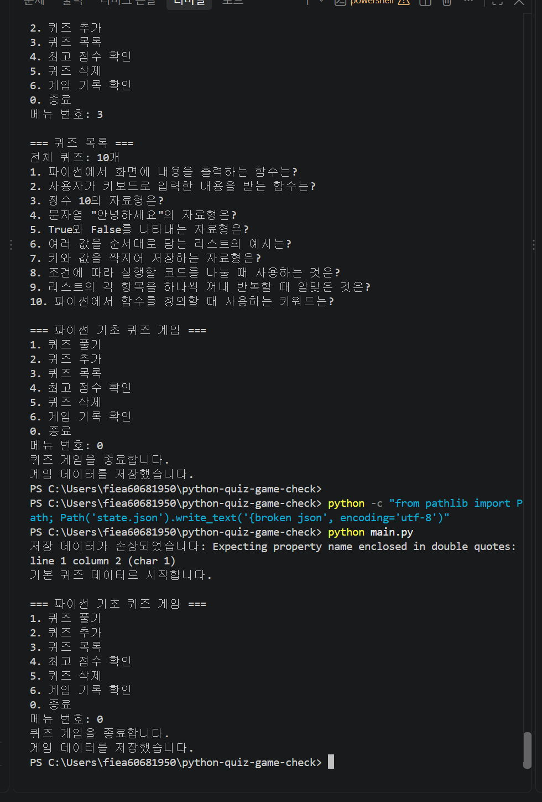

## 빈 퀴즈와 기록 처리

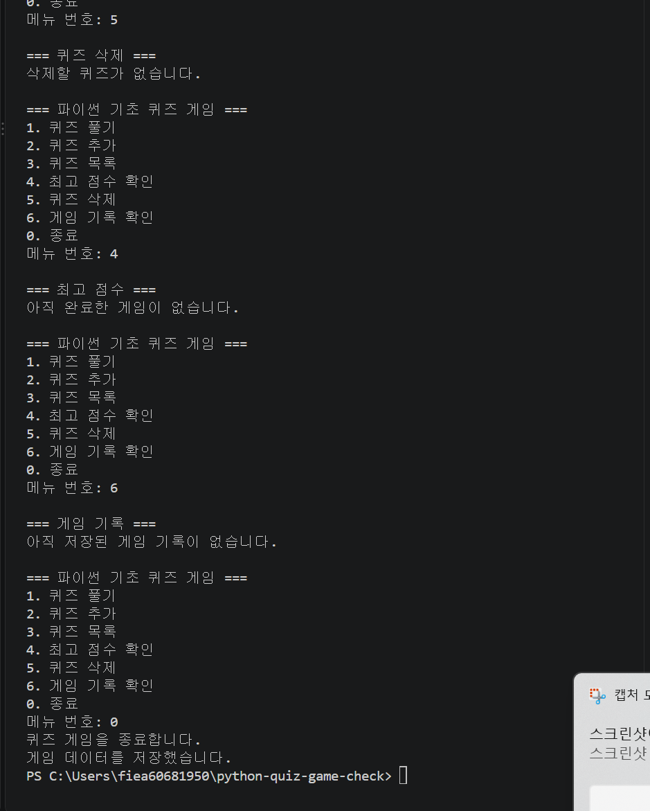

## 파일 오류 모의 검증

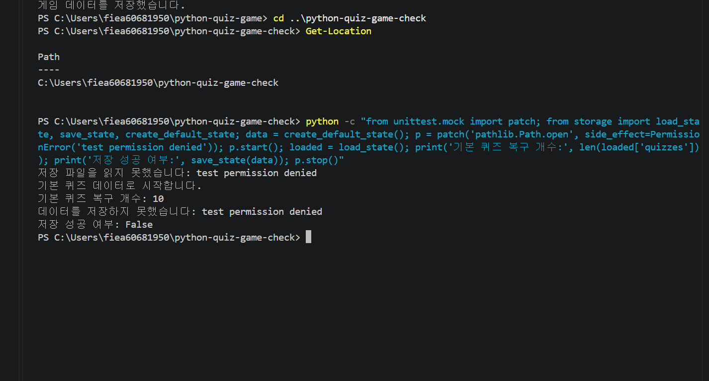


