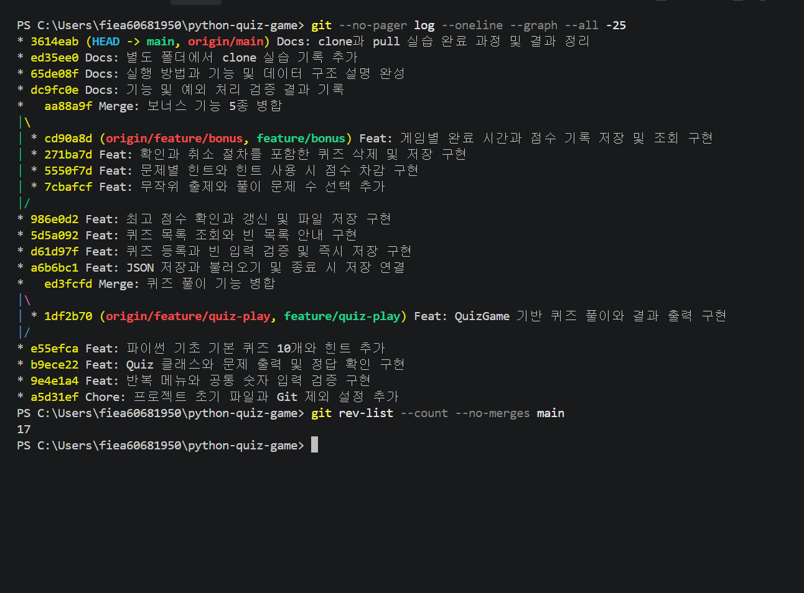

# 커밋 수 및 의미 있는 변경 증빙 (#5)

## 실제 실행 화면

아래는 사용자가 Windows PowerShell에서 실제 실행해 업로드한 원본 사진입니다. 재구성한 화면이 아닙니다.
스크린샷 촬영 당시 병합을 제외한 커밋 수는 **17개**였습니다.



## 현재 원격 저장소 스냅샷

2026-11-11에 GitHub API로 main 이력을 조회했습니다. 기준 HEAD는 `7a35753f6ff5447205c424f60e0afdf1b16c1496`입니다.
전체 21개 중 병합 2개를 제외한 **일반 커밋 19개**입니다. 사진의 17개 이후 증빙 문서 관련 커밋 2개가 추가됐습니다.
위 개수는 수정 전 이력 스냅샷이며, 이후 수정 커밋은 포함하지 않습니다.

[조회 원자료](evidence/commit-snapshot.json) · [실제 GitHub 이력](https://github.com/SonJH0/python-quiz-game/commits/main/)

| SHA | 종류 | 실제 커밋 메시지 |
|---|---|---|
| [7a35753](https://github.com/SonJH0/python-quiz-game/commit/7a35753f6ff5447205c424f60e0afdf1b16c1496) | 일반 | Docs: 증빙 제목과 설명 문구 및 원본 이미지 제외 설정 정리 |
| [80fd22c](https://github.com/SonJH0/python-quiz-game/commit/80fd22c528e94a3ea56f1f260039c677533301cc) | 일반 | Docs: 제출용 실행 화면 14장과 README 이미지 추가 |
| [3614eab](https://github.com/SonJH0/python-quiz-game/commit/3614eab6228ffd872fab63a6c41778202dc65d41) | 일반 | Docs: clone과 pull 실습 완료 과정 및 결과 정리 |
| [ed35ee0](https://github.com/SonJH0/python-quiz-game/commit/ed35ee0150b14aaab6f762f5764c30212bd0e94c) | 일반 | Docs: 별도 폴더에서 clone 실습 기록 추가 |
| [65de08f](https://github.com/SonJH0/python-quiz-game/commit/65de08f5e0332b44fb6335f61ad8e81a0ecafbdf) | 일반 | Docs: 실행 방법과 기능 및 데이터 구조 설명 완성 |
| [dc9fc0e](https://github.com/SonJH0/python-quiz-game/commit/dc9fc0e258f3a70df7c5e4f63770070f52600480) | 일반 | Docs: 기능 및 예외 처리 검증 결과 기록 |
| [aa88a9f](https://github.com/SonJH0/python-quiz-game/commit/aa88a9fb6a7682030c49735863a48b7256d95fea) | 병합 | Merge: 보너스 기능 5종 병합 |
| [cd90a8d](https://github.com/SonJH0/python-quiz-game/commit/cd90a8d61ce34e7eb68824f3df6c6b9161732a8b) | 일반 | Feat: 게임별 완료 시간과 점수 기록 저장 및 조회 구현 |
| [271ba7d](https://github.com/SonJH0/python-quiz-game/commit/271ba7dee92d7ab1e743c29f6e8a14c5075d4797) | 일반 | Feat: 확인과 취소 절차를 포함한 퀴즈 삭제 및 저장 구현 |
| [5550f7d](https://github.com/SonJH0/python-quiz-game/commit/5550f7decbdc97de4fa586115fcc264786d67f63) | 일반 | Feat: 문제별 힌트와 힌트 사용 시 점수 차감 구현 |
| [7cbafcf](https://github.com/SonJH0/python-quiz-game/commit/7cbafcf8c295d3609b13cbffd4f3a190878908d2) | 일반 | Feat: 무작위 출제와 풀이 문제 수 선택 추가 |
| [986e0d2](https://github.com/SonJH0/python-quiz-game/commit/986e0d28659ca7734f47f2bfbd71dedf4622a438) | 일반 | Feat: 최고 점수 확인과 갱신 및 파일 저장 구현 |
| [5d5a092](https://github.com/SonJH0/python-quiz-game/commit/5d5a0921cd4423a0a1cfc53c81fb3f28c714c583) | 일반 | Feat: 퀴즈 목록 조회와 빈 목록 안내 구현 |
| [d61d97f](https://github.com/SonJH0/python-quiz-game/commit/d61d97f0e05bfec225aaab0edc567212ed3ad6b9) | 일반 | Feat: 퀴즈 등록과 빈 입력 검증 및 즉시 저장 구현 |
| [a6b6bc1](https://github.com/SonJH0/python-quiz-game/commit/a6b6bc146c13e8ba0e9b643ae20fa384eb7f49f3) | 일반 | Feat: JSON 저장과 불러오기 및 종료 시 저장 연결 |
| [ed3fcfd](https://github.com/SonJH0/python-quiz-game/commit/ed3fcfd9f2a26f35f4a97cae0b918680bf8fab3d) | 병합 | Merge: 퀴즈 풀이 기능 병합 |
| [1df2b70](https://github.com/SonJH0/python-quiz-game/commit/1df2b70bbd409b51057bd7ff85574e938cc9ca2b) | 일반 | Feat: QuizGame 기반 퀴즈 풀이와 결과 출력 구현 |
| [e55efca](https://github.com/SonJH0/python-quiz-game/commit/e55efcabaafad0655040188b375fa1c3b57d11ab) | 일반 | Feat: 파이썬 기초 기본 퀴즈 10개와 힌트 추가 |
| [b9ece22](https://github.com/SonJH0/python-quiz-game/commit/b9ece22b2bea9aa9210cb8caa21451844c791f85) | 일반 | Feat: Quiz 클래스와 문제 출력 및 정답 확인 구현 |
| [9e4e1a4](https://github.com/SonJH0/python-quiz-game/commit/9e4e1a474b0cd2bb38e39ec1da31eac81f378791) | 일반 | Feat: 반복 메뉴와 공통 숫자 입력 검증 구현 |
| [a5d31ef](https://github.com/SonJH0/python-quiz-game/commit/a5d31ef3ba7b5a5be8a4fb02dc31d47cf0bb2706) | 일반 | Chore: 프로젝트 초기 파일과 Git 제외 설정 추가 |

## 의미 있는 커밋 판단

메뉴 입력 검증, Quiz 클래스, 기본 문제, 게임 진행, JSON 저장, 등록, 목록, 최고 점수, 랜덤/문제 수, 힌트, 삭제, 기록처럼 실제 책임과 기능이 달라지는 단위로 기록했습니다. 문서 커밋은 실행 방법, 검증 결과, clone/pull, 증빙 이미지의 변경을 각각 담습니다. 커밋 개수만 채우기 위한 빈 커밋은 만들지 않았습니다.

현재 로컬 저장소에서 재확인하는 명령:

```powershell
git log --oneline --graph --all
git rev-list --count --no-merges main
```

패키지를 적용한 뒤 커밋하면 현재 개수는 증가합니다. 스냅샷과 사진은 해당 기준 시점의 증거로 유지합니다.
