# 실행 화면 및 제출 증빙

제출용 화면 14장을 선별해 이름을 정리했습니다. 이미지는 업로드한 원본 그대로입니다.
그 밖의 업로드 사진은 screenshots/originals 폴더에 보관했습니다.

## 개발 환경

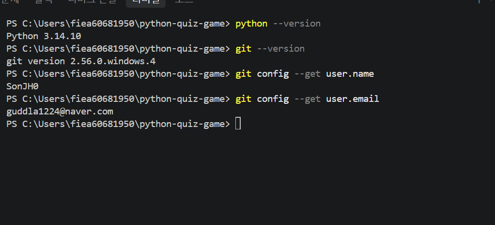

## 퀴즈 추가

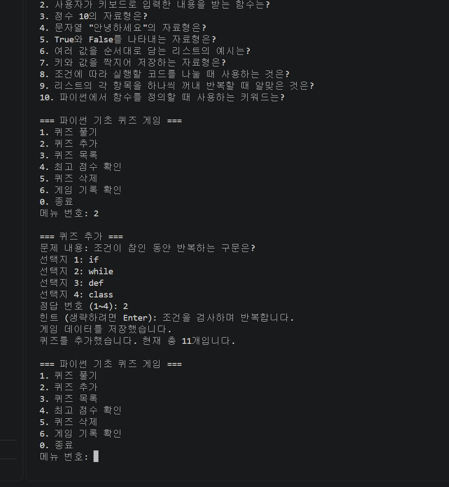

## 퀴즈 목록

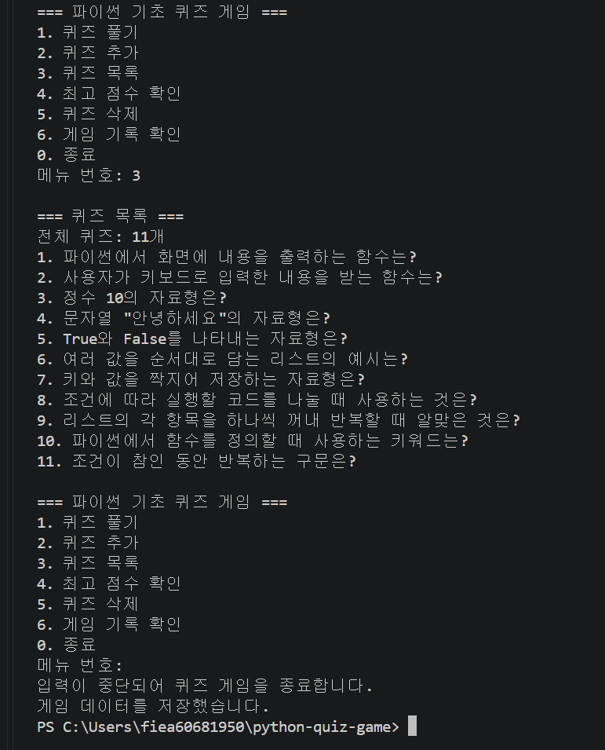

## 플레이와 힌트

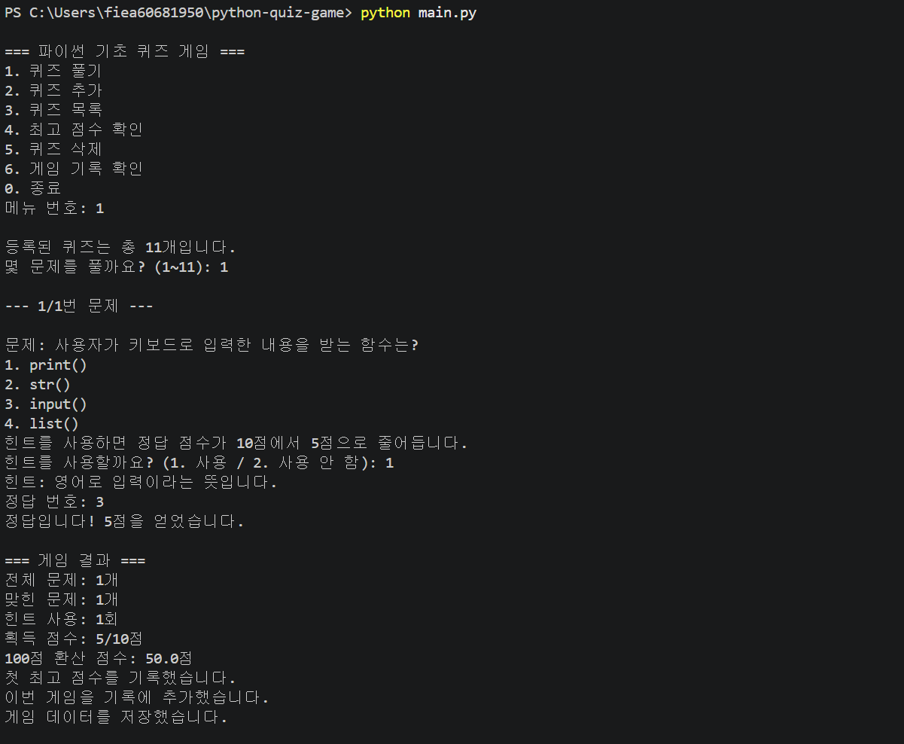

## 최고 점수

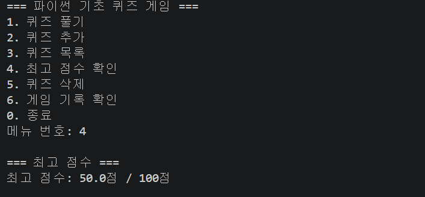

## 게임 기록

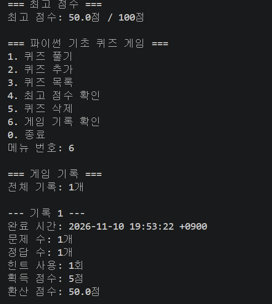

## Git 변경 및 병합 기록

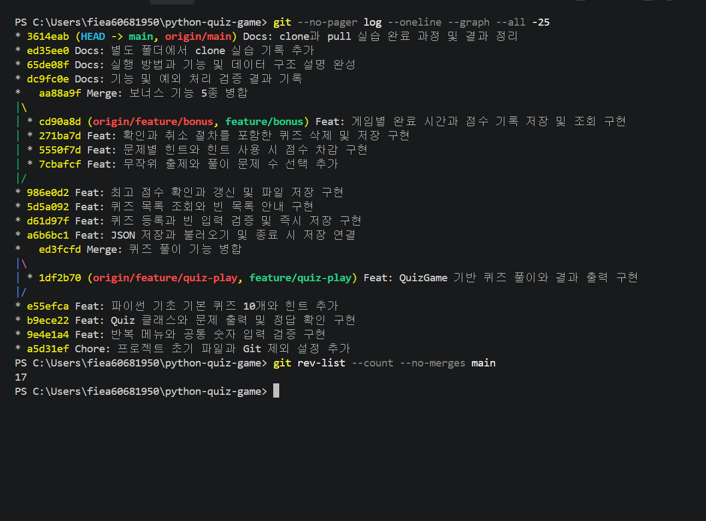

## clone 실행

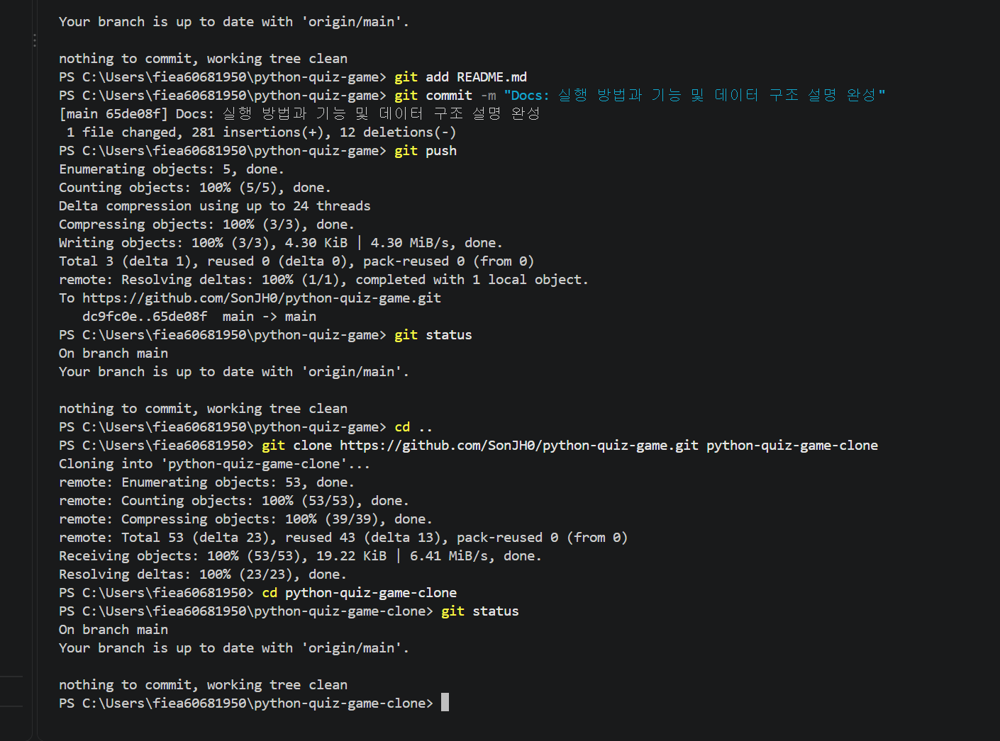

## pull 및 변경 반영

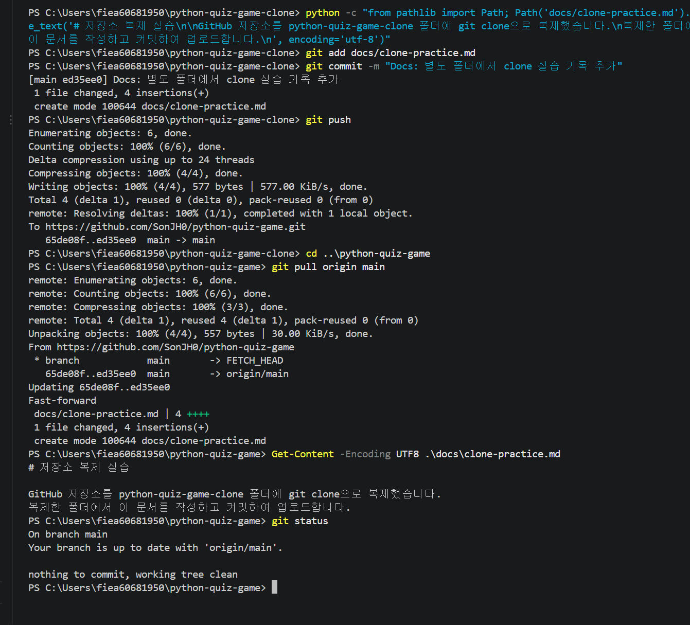

## 삭제 및 목록 확인

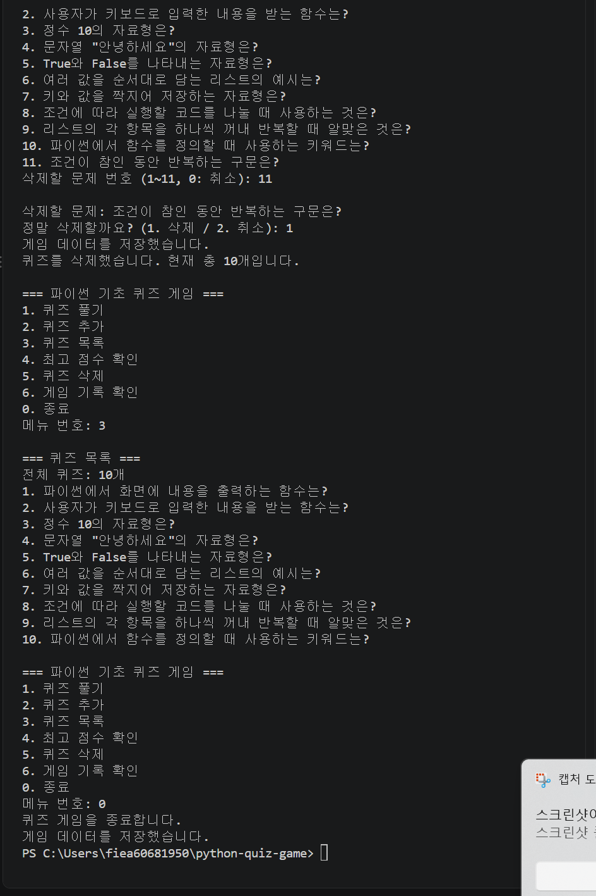

## Ctrl+C 및 EOF 종료

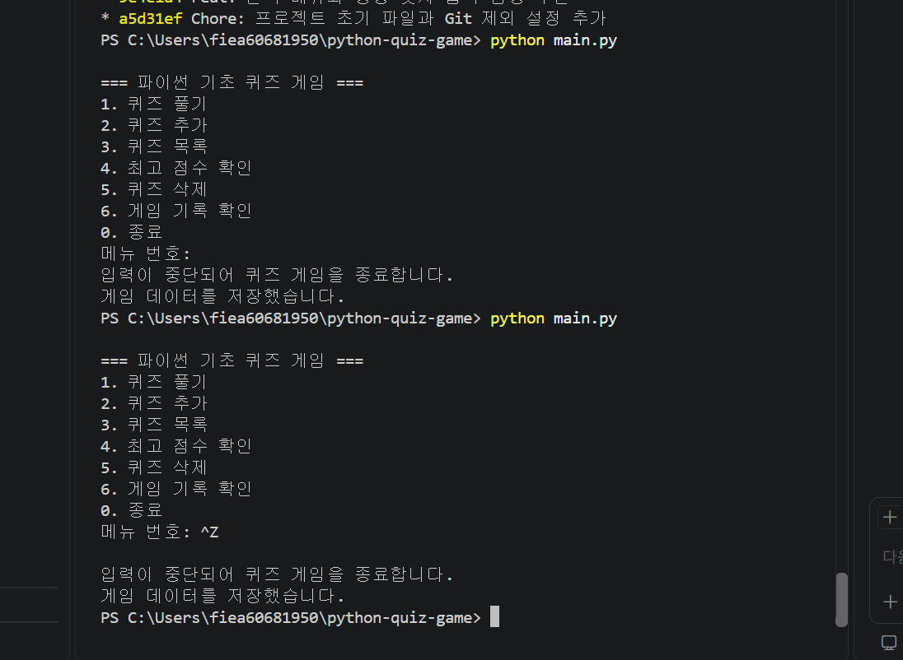

## JSON 손상 복구

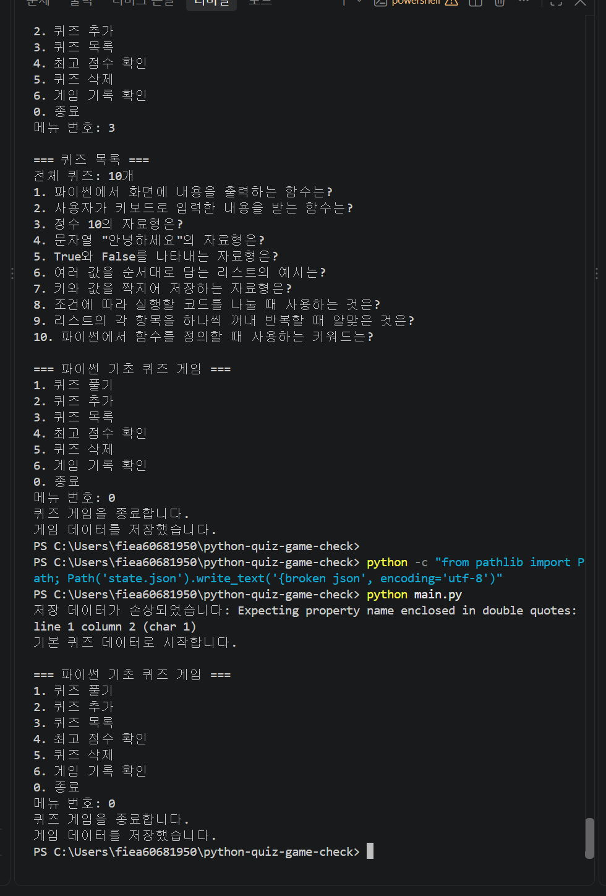

## 빈 퀴즈와 기록 처리

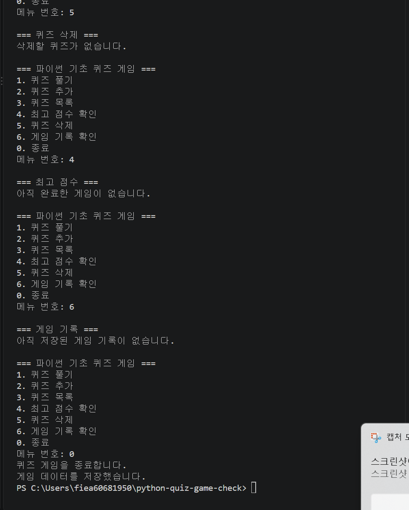

## 파일 오류 모의 검증

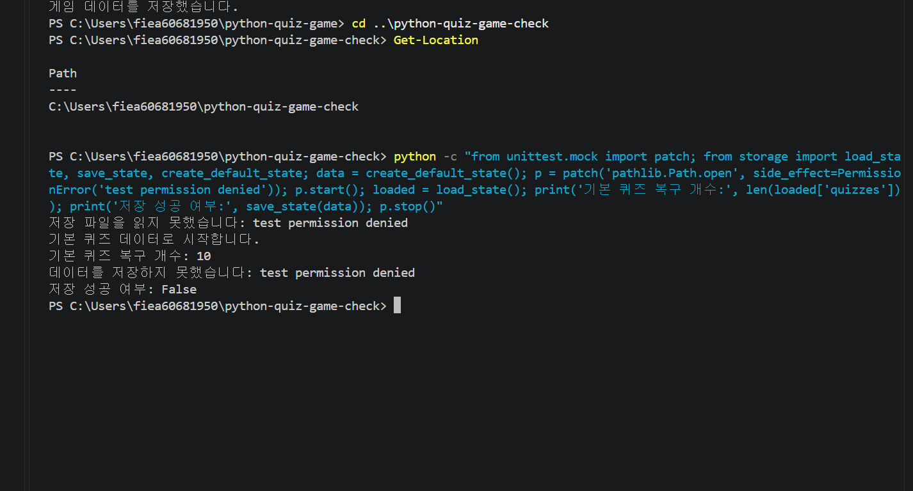

